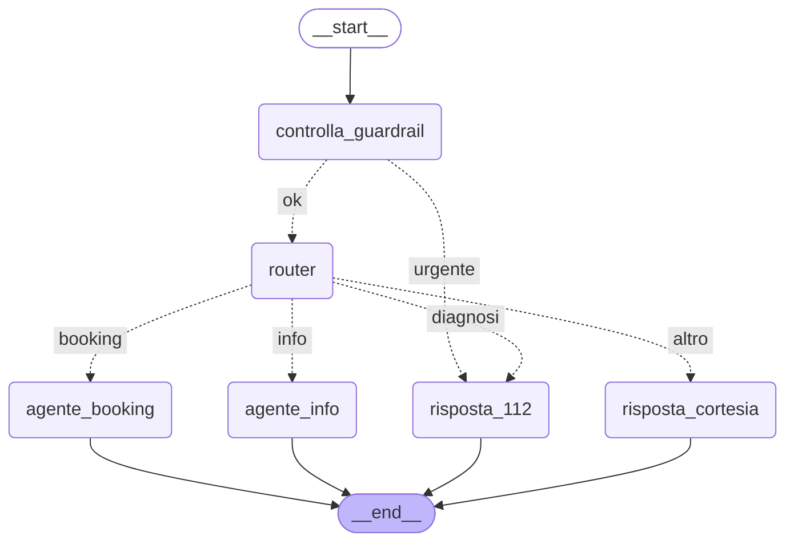

# MediBook – Poliambulatorio Salus Levante

Assistente conversazionale per il Poliambulatorio Salus Levante, realizzato con **LangGraph** per la
**Traccia C – MediBook** del project work.
Il paziente si identifica con il codice fiscale e può:

- chiedere informazioni sulla Carta dei Servizi (orari, tariffe, preparazione, documenti, disdette, pagamenti);
- prenotare una visita specialistica, con conferma prima della scrittura nel database e ricevuta JSON;
- vedere le proprie visite prenotate.

Le richieste di diagnosi e i sintomi urgenti, riconosciuti da un guardrail a parole chiave e dal router,
ricevono una risposta standard che rimanda al 112, senza consigli medici.

## Modello usato

Modelli **locali** con [Ollama](https://ollama.com):

| Uso | Modello |
|---|---|
| Chat, router e agenti | `qwen2.5:latest` |
| Embedding per il RAG | `bge-m3:latest` |

I modelli si scelgono solo in `config.py` (o con le variabili d'ambiente `OLLAMA_MODEL` e
`OLLAMA_EMBED_MODEL`). Nel codice non ci sono chiavi.

## Installazione e avvio

1. Creare e attivare un ambiente virtuale:
   ```
   python -m venv .venv
   .venv\Scripts\activate
   ```
2. Installare le librerie:
   ```
   pip install -r requirements.txt
   ```
3. Scaricare i modelli (se `ollama list` non li mostra):
   ```
   ollama pull qwen2.5:latest
   ollama pull bge-m3:latest
   ```
4. Creare il database `medibook.db` da `schema.sql` (si crea anche da solo al primo avvio se manca;
   rilanciarlo riporta il database ai dati di prova):
   ```
   python db.py
   ```
5. Avviare l'assistente:
   ```
   python main.py
   ```

Comandi della chat:

| Comando | Dove | Cosa fa |
|---|---|---|
| `/prenotazioni` | nella conversazione | mostra le visite future confermate del paziente, lette dal database |
| `/esci` | nella conversazione | chiude la conversazione e torna alla richiesta del codice fiscale |
| `/fine` | al posto del codice fiscale | chiude il programma |

Per le prove ci sono 8 pazienti di fantasia in `schema.sql`, per esempio `RSSMRA90A01H501X` (Mario Rossi).
Gli orari prenotabili vanno dal 03-11-2026 al 27-11-2026, dal lunedì al sabato.

## Architettura

Diagramma del grafo principale (generato con `draw_mermaid()` da `main.py`, copia in `grafo.md`):



| Nodo | Cosa fa |
|---|---|
| `controlla_guardrail` | controllo nel codice, senza LLM: se il messaggio contiene parole di urgenza o richieste di diagnosi va subito a `risposta_112` |
| `router` | LLM con output strutturato (Pydantic, `Literal["info", "booking", "diagnosi", "altro"]`); ignora i messaggi precedenti all'ultima risposta del 112, così il paziente può prenotare dopo aver parlato di un sintomo |
| `risposta_112` | risposta standard fissa: nessuna diagnosi, rimando al 112, proposta di prenotare una visita |
| `agente_info` | **sottografo** `recupera → genera` (`rag.py`): cerca nella Carta dei Servizi e risponde citando la sezione |
| `agente_booking` | agente `create_agent` usato come nodo (`booking.py`), con i tool `data_di_oggi`, `cerca_medici`, `cerca_slot_liberi`, `prenota_visita` |
| `risposta_cortesia` | risposta fissa per saluti e richieste fuori tema |

Memoria:

- **checkpointer** `InMemorySaver`: memoria della singola conversazione (`thread_id` = codice fiscale + numero della conversazione);
- **store** `InMemoryStore`: preferenze del paziente condivise tra le sue conversazioni (facoltativo Store).

## Database (SQLite)

`schema.sql` crea 5 tabelle con dati di prova: `specialita` (5), `medici` (6), `slot` (258), `pazienti` (8),
`prenotazioni` (1 di esempio).

- chiavi primarie ed esterne, con `PRAGMA foreign_keys = ON` a ogni connessione (`db.py`);
- vincoli `CHECK`: costi positivi, `libero` 0 o 1, codice fiscale di 16 caratteri maiuscoli,
  tipo di visita e stato della prenotazione tra i valori ammessi;
- `UNIQUE (medico_id, data_ora)` sugli slot;
- indice unico parziale `prenotazione_confermata_per_slot`: al massimo una prenotazione **confermata** per slot.

## Prenotazione sicura

Il tool `prenota_visita`:

1. legge il codice fiscale dalla configurazione della chat (`config["configurable"]["codice_fiscale"]`), non dall'LLM;
2. controlla tipo di visita, esistenza e disponibilità dello slot, data futura;
3. calcola l'importo **nel codice** dalla tariffa della specialità;
4. prende la preparazione alla visita dalla sezione "Preparazione agli esami" del PDF;
5. si ferma con `interrupt()` e mostra il riepilogo: senza "si" non scrive niente;
6. dopo il "si", nella **stessa transazione**: `UPDATE slot SET libero = 0 WHERE id = ? AND libero = 1`
   e `INSERT` della prenotazione (o tutte e due o nessuna);
7. salva la ricevuta `ricevute/ricevuta_NNN.json`, con la preparazione e la sua fonte.

Tutte le query sono parametriche (`?`).
Il numero di prenotazione non compare nel riepilogo perché lo crea il database al momento dell'`INSERT`,
cioè dopo il "si": si vede con `/prenotazioni` e nella ricevuta.

## RAG sulla Carta dei Servizi

- il PDF `data/carta_servizi_poliambulatorio.pdf` viene diviso in **un chunk per ciascuna delle 7 sezioni**,
  così la citazione indica una sezione vera e i paragrafi non vengono spezzati;
- gli embedding (`bge-m3`) sono salvati in Chroma nella cartella `chroma_db/` (creata solo la prima volta);
- il nodo `genera` ha l'istruzione (nel prompt) di rispondere solo con il contesto trovato e di citare la sezione;
- la preparazione per la ricevuta viene letta direttamente dalla sezione "Preparazione agli esami",
  senza ricerca per similarità.

## Facoltativi svolti

Dichiarati anche in `facoltativi.txt`.

- **Store: preferenze del paziente (medico, fascia oraria)** – dopo ogni prenotazione confermata vengono
  salvati in automatico il medico e la fascia (mattina o pomeriggio); al nuovo accesso dello stesso paziente
  sono mostrati e negli orari liberi compaiono le note "medico preferito" e "fascia preferita".
- **Streaming custom ("sto cercando...")** – il router, l'agente Info e i tool `cerca_medici`,
  `cerca_slot_liberi` e `prenota_visita` mandano messaggi di avanzamento con `get_stream_writer()`; `main.py` li stampa usando
  `grafo.stream(..., stream_mode=["custom"], subgraphs=True)` (`subgraphs=True` serve perché gli agenti sono sottografi).
  In `prenota_visita` i messaggi stanno dopo l'interrupt, perché alla ripresa il tool riparte dall'inizio.

## Limiti noti

Osservati nei test con `qwen2.5:latest`:

- **Orari inventati**: a volte l'LLM risponde con un orario senza chiamare `cerca_slot_liberi`.
  Lo streaming lo rende visibile (manca la riga "... Sto cercando gli orari liberi..."). Non può però
  nascere una prenotazione da un orario inventato: riepilogo e scrittura passano solo da `prenota_visita`,
  che controlla lo slot nel database.
- **Slot scelto dall'LLM**: a volte l'LLM va al riepilogo con uno slot che il paziente non ha scelto.
  Il riepilogo lo mostra e basta rispondere "no".
- **Date relative** ("la prossima settimana", "lunedì prossimo"): poco affidabili, perché il modello
  non chiama `data_di_oggi`. Se cerca in una data passata riceve un errore con la data di oggi.
  Conviene scrivere la data come GG-MM-AAAA oppure "oggi", "domani", "dopodomani".
- **Numero di prenotazione**: dopo la conferma l'assistente di solito lo comunica, ma non sempre;
  il riferimento sicuro è `/prenotazioni`.
- **Router**: alcune frasi incerte vengono classificate male (per esempio "forse mi serve una visita
  oculistica" dopo un sintomo è finita in "diagnosi"; "quali medici ci sono in ortopedia?" è andata a info).
- **Guardrail a parole chiave**: possibili falsi positivi, per esempio "emergenza di lavoro",
  "ictus di mio padre", "che farmaci devo prendere con me".
- **Memoria in RAM**: conversazioni e preferenze si perdono chiudendo il programma (`InMemorySaver`, `InMemoryStore`).
- **Comandi esatti**: `/prenotazioni` e `/esci` vanno scritti esattamente così (`/fine` accetta anche
  maiuscole e spazi); `/fine` funziona solo al posto del codice fiscale; durante la conferma
  `/prenotazioni` vale come "no".
- **Registro**: i testi fissi mescolano il Lei e il tu (per esempio "le sue visite" e "Confermi la prenotazione?"),
  e anche le risposte dell'LLM a volte danno del tu.
- **Disdetta con penale (facoltativo non incluso)**: è stata provata, ma con qwen2.5 serviva una regola nel
  prompt dell'agente Booking che peggiorava la ricerca degli orari (ricerca riuscita 12 volte su 12 senza
  la regola, 9 su 12 con la regola), quindi non è stata inclusa.

## Struttura dei file

| File o cartella | Contenuto |
|---|---|
| `main.py` | punto di ingresso: guardrail, router, grafo principale, chat da terminale, salvataggio di `grafo.md` |
| `booking.py` | agente Booking: query SQL, transazione, tool, ricevuta, preferenze |
| `rag.py` | RAG sulla Carta dei Servizi e sottografo dell'agente Info |
| `db.py` | connessione SQLite e creazione del database da `schema.sql` |
| `schema.sql` | tabelle, vincoli e dati di prova |
| `config.py` | scelta dei modelli Ollama |
| `requirements.txt` | librerie Python |
| `grafo.md` | diagramma Mermaid del grafo |
| `facoltativi.txt` | traccia presentata e facoltativi svolti |
| `Traccia 3.ipynb` | notebook che mostra i tool e la struttura dell'agente Booking |
| `data/carta_servizi_poliambulatorio.pdf` | Carta dei Servizi usata dal RAG |
| `medibook.db`, `chroma_db/`, `ricevute/` | creati durante l'esecuzione: database, indice vettoriale, ricevute JSON |
